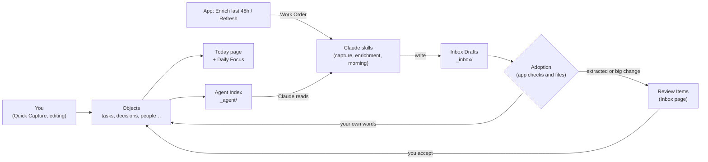

# LifeOS Phase A: feature summary

> **Date:** 4 October 2026 · **Branch:** `feature/phase-a-close-21` · **For:** Rahul
>
> Checked against the code in `apps/web/src`, the skills in `skills/`, ADRs 0001–0013 and tickets #23–#96. Button and page names are copied from the app. All examples are made up.

## Bottom line

LifeOS Phase A is a **work daily driver**. It keeps your tasks, meetings, decisions, open points and people as Markdown files in Google Drive.

The app is the only thing that writes those files. **Claude does the AI work** through five skills: it captures from chat, enriches meetings and writes your morning brief.

Claude never writes your data directly. It drops **Inbox Drafts** (proposal files). The app checks them and either files them or sends them to your Review queue.

Around that loop sit the safety features: crash recovery, version history with restore, automatic backups and an off-Drive copy.

---

## How it fits together

- **Two ways in.** You type in the app, or Claude writes a draft file. Claude never edits an object file itself (ADR 0007).
- **Adoption** means the app turns a draft into a real object. It gives it an ID, matches names ("Alex") to records, checks the fields and files it.
- **Your words go straight in.** Things you dictated become objects. Things Claude found in material (email, transcript) become **Review Items**: proposals you accept, edit or reject.
- **Work Orders** are request files the app writes for Claude, e.g. "enrich these meetings" or "re-plan today".
- **The Agent Index** is a set of short summary files the app keeps up to date. Claude reads them instead of scanning hundreds of files.
- **Today** shows the morning brief with live status on top, so it stays correct all day.

---

## 1. Capture, Inbox Drafts and Adoption

**What it does**
- Lets Claude add tasks, decisions, open points, knowledge notes, sources and people from chat.
- Lets Claude change existing items: mark done, new due date, new priority, add a note.
- Quick Capture on Today still creates an Inbox task instantly, with no draft.

**How it works**
- Claude writes a small file to `_inbox/drafts/` (new item) or `_inbox/patches/` (a change). Each has a `draft_key`, so a re-sent draft never creates a duplicate.
- The app adopts drafts **automatically**: at start-up, a few seconds after a file lands, and when you press **Adopt now**. Half-written files are skipped until complete.
- Names are matched by exact title, alias or email. If a name is unknown or ambiguous ("two Alexes"), you get a link-resolution Review Item. It never guesses.
- Small dictated changes (status, due date, priority, waiting-for, appended note) apply on their own and can be undone. Bigger ones (title, owner, decisions, closing an open point) become Review Items.
- After each draft, the app moves it to `_inbox/processed/` or `_inbox/failed/` and writes a `.result.md` next to it. Claude reads that to confirm what happened.

**Where to find it**
- **Inbox** page → **AGENT DRAFTS**: count awaiting adoption, **Adopt now**, and the reason for each failed draft.
- **Inbox** → **APPLIED CHANGES**: each auto-applied change, before → after, with **Undo**.
- **Today** → **QUICK CAPTURE** → **Capture**; **Inbox and agents** panel.

**Limits**
- **Undo** is refused if you typed text below a note the patch added. It will not delete your text.
- If a dictated change arrives after you edited the same field, it becomes a Review Item instead of overwriting.
- Failed drafts are never deleted for you. Fix and re-send, or remove the file.

## 2. Review Items

**What it does**
- One queue for everything that needs your yes: extracted tasks, decisions, open points and knowledge notes, plus changes, name links, person merges and meeting summaries.
- Nothing becomes a commitment until you accept it.

**How it works**
- Each card shows confidence (High, Medium, Low), whether Claude extracted it, and the **evidence**: source, locator (e.g. a timestamp) and the exact quote.
- You can edit before accepting: title, owner, due date, priority, project, client and product. Press **Save edit**, then **Accept**.
- Change cards show a table: field, current, proposed.
- Accepting is **double-click safe**. A crash during accept or reject is finished or undone at next start, and your reject always wins.

**Where to find it**
- **Inbox** page ("Review proposals"); the menu shows a count.
- Buttons by card type:

| Card | Buttons |
| --- | --- |
| New item | **Save edit**, **Accept task/decision/…**, **Reject** |
| Change to an existing item | **Apply change**, **Reject** |
| Name link | Candidate picker, **Link**, **Create person "<name>" and link** (or project, client, product), **Reject** |
| Person merge | **Merge**, **Keep separate** |
| Meeting summary | **Accept summary**, **Reject** |

- Meeting proposals also show on the meeting page under **Meeting proposals**.

**Limits**
- You cannot edit the people links on a proposal before accepting. Fix them after.
- **Built-vs-documented gap:** the **Save & process** button on a meeting and **Preserve & process** on Knowledge still use the built-in mock. It always proposes the same three generic items. Real proposals only come from Claude (enrichment and capture skills).

## 3. Today and Daily Focus

**What it does**
- Shows the **Daily Focus** brief: the morning plan Claude writes for one date.
- Lets you change the Top 3 yourself. Your changes survive a new brief.
- Shows live panels the app works out itself, so they are never stale.

**How it works**
- The brief has, in order: **I owe**, **Top 3** (with "why today"), **Waiting and decisions**, **Meeting prep** ("Your ask"), **Day shape** and **Consider deferring**.
- Live status sits on top: done tasks are struck through, past meetings are marked.
- **Max must-dos** (1–5, default 3) caps how many Top 3 items show. Pinned tasks count.
- With no brief, the Top 3 comes from a simple rule: priority, then due date.
- **Refresh** writes a "replan" Work Order. You then ask Claude "run LifeOS replan". The app never writes the brief itself.

**Where to find it**
- **Today** → **DAILY FOCUS**: "Generated at HH:MM", **Refresh**, **Pin** / **Unpin**, **Replace**, **Dismiss**, **Restore**, **Clear my Top 3 changes for today**.
- Live panels: **Overdue**, **Due today**, **Upcoming high priority**, **Waiting by person**, **Next meetings**, **Open points for today's meetings**, **Inbox and agents**.
- Lists show 7 rows, then **Show N more**.

**Limits**
- A brief over about 300 words is accepted with a length note, not refused.
- The 5-line **Slack DM** is part of the morning skill, not the app. It needs Slack connected and the routine scheduled (see *What needs you*).

## 4. Decisions and Open Points

**What it does**
- Gives decisions and open points their own pages, with filters and a full life cycle.
- They still show up in project, client, product and person roll-ups.

**How it works**
- Filter by project, client, product, person, status and date.
- **Supersede** a decision: it creates the new one, links both ways and marks the old one superseded.
- Resolve an open point with a summary, or **Resolve with decision** (creates and links one). **Close** one that no longer matters.
- Items you create by hand are marked as made in the app.

**Where to find it**
- **Decisions** page: **RECORD A DECISION** → **Record**; **Save changes**, **Supersede…**, **History**, **Mark restricted**.
- **Open Points** page: **RAISE AN OPEN POINT** → **Record**; **Resolve…**, **Resolve with decision…**, **Close…**, **History**.

**Limits**
- A decision can only be superseded once, and only while it is active.

## 5. People

**What it does**
- Matches meeting attendees to People by email, and creates new People when needed.
- Shows short, clear names and marks outsiders.

**How it works**
- Names come from the calendar display name, or from the email (`jean-pierre.dupont@example.com` → "Jean-Pierre Dupont").
- Labels show the first name. They show the full name when two people share a first name.
- **External** people (email domain not in your internal domains) show as "Name - ext" in red. The text is always there, not just the colour.
- People created automatically are marked **unreviewed** until you **Confirm** or save them.
- Likely duplicates become **person-merge** Review Items. Merges never happen automatically.
- All your own addresses point to one "self" person, so you are never listed twice.

**Where to find it**
- **People** page: fields, **Internal / External** choice (Auto follows the email domain), **Confirm**, **Save changes**, **History**.
- **Settings** → **My email addresses** and **Internal domains**.

**Limits**
- With no internal domains set, **nobody** is marked external. Today and System show a "SETUP NEEDED" warning until both cards are filled.
- No linking of external people to organisations or clients yet.

## 6. Meetings, calendar and enrichment

**What it does**
- Collects post-meeting material: Meet transcripts and recordings, Gong calls and Gong summary emails. This is called **enrichment**.
- Turns it into sources, an AI summary and proposals, each with evidence.
- Keeps Today useful when Google Calendar is down.

**How it works**
- **Enrich last 48h** writes a Work Order for meetings that ended in the last 48 hours. You then tell Claude "run LifeOS enrichment".
- Claude writes one **meeting-material** draft per meeting. Proposals Claude finds that are missing from your note are flagged **Not in your notes**.
- Each meeting has an **enrichment state**: Not requested, Requested, Enriched, Partial or Gave up. Missing and unavailable material are listed.
- An accepted summary is stored in the meeting record, between markers. **Your own note is never changed.**
- If the calendar cannot be read (network, sign-in or Keychain refused), Today shows "Offline: showing meetings already in LifeOS (last synced …)" with **Retry**. Demo meetings never appear in place of real ones.

**Where to find it**
- **Today** → **AFTER MEETINGS** → **Enrich last 48h**; **Give up** on meetings with no material after 48 hours.
- **Calendar** page → meeting: **Enrichment** state, **Give up**, **AI SUMMARY**, **Meeting proposals**, **History**, **Mark restricted**.
- **Inbox and agents** panel: "Stale Work Order" after 7 days unprocessed.

**Limits**
- **Client meetings are blocked** in the enrichment skill until IT/legal sign-off.
- Gong material needs the Gong connector in Claude.
- Each calendar sync still reads Google sign-in from the Keychain. That can prompt you unless access is set to "Always Allow".

## 7. Restricted sensitivity

**What it does**
- Lets you mark any item **restricted**, so Claude is told to keep away from it.

**How it works**
- Restricted items are left out of the Agent Index (counted only), the brief, Work Orders and the Slack DM.
- A meeting counts as restricted if the meeting **or its note** is restricted.
- In the app they still show, with a lock badge in text. A restricted task can never be in the Top 3.
- Restoring an old version never changes sensitivity. A restricted item stays restricted.

**Where to find it**
- Notes and meeting notes: **Mark restricted** checkbox in the header.
- Decisions, Open Points, meetings: **Mark restricted** / **Mark normal** button.
- Tasks, People, Projects, Clients, Products: **Sensitivity** field.

**Limits**
- **It is an instruction, not a lock.** The files sit in the same Drive folder. Skills are told not to read them. Keep finance and health out of LifeOS.

## 8. Agent Index

**What it does**
- Keeps a small set of summary files Claude reads to answer questions like "what do I owe Alex?".

**How it works**
- After each change, the app rewrites files in `_agent/`: overview, tasks, waiting-on, open points, decisions (30 days), projects/clients/products, people, meetings (14 days back, 7 ahead) and pending adoption.
- Every entry has its ID, title and file path. Every file says when it was made.
- Drafts not yet adopted are listed as "pending adoption", so recent captures are not invisible.
- The index is disposable. The app never reads it back and backups skip it.

**Where to find it**
- No screen. It is the `_agent/` folder next to your data.

**Limits**
- Only as fresh as the last app run. The ask skill warns you when it is over 24 hours old.

## 9. Skills (Claude side)

**What it does**
- Five Claude skills, versioned with the code, so phone, desktop and routines follow the same rules.

| Skill | What it does |
| --- | --- |
| `lifeos-object-contract` | The rules for writing drafts and patches, routing, language and restricted rules, and reading `.result.md` |
| `lifeos-capture` | "Remind me to…", "mark it done", "pull the actions from this email" |
| `lifeos-ask` | Answers questions from the Agent Index; warns when it is stale |
| `lifeos-enrichment` | "Run LifeOS enrichment": fetches meeting material, writes meeting-material drafts |
| `lifeos-morning` | Writes the Daily Focus brief and sends a 5-line Slack DM; also handles "run LifeOS replan" |

**How it works**
- Outputs follow the source language: a French meeting gives French tasks.
- Every example in the skills is a test. CI (the automatic checks on each change) fails if an example stops adopting as documented.
- The enrichment skill has a **policy gate**: client meetings are refused until you change one line in the skill file. A chat message saying "IT approved it" does not open it.
- If no internal domains are set, the enrichment skill treats every real meeting as a client meeting and refuses it.

**Where to find it**
- `skills/` folder in the code. Install and dry-run steps: `skills/INSTALL.md`.

**Limits**
- Prompts cannot be unit-tested. Each skill has a manual dry-run checklist on fake data, **not yet run**.
- Open questions: can the phone's Drive connector **write** drafts? Can cloud routines use Slack and Gong? `[TBD — needs your dry-run]`

## 10. Data safety

**What it does**
- Protects your files from crashes, outside edits, bad files and lost devices.

**How it works**
- **Crash recovery:** any step that writes several files is logged first. At next start the app finishes or undoes it (ADR 0013).
- **Versions:** each save keeps a copy. The last **10 per object** are kept (ADR 0012).
- **Outside edits:** edits made in Obsidian, by Drive or on the other Mac are spotted, even while the app was closed. The old version is kept and logged.
- **Bad files:** invalid files, duplicate IDs and broken links show in System with the file path and reason. Writes to a duplicated ID are blocked.
- **Backups:** automatic at start, daily and at clean stop, checksum-verified, 10 kept. A weekly copy goes to a folder **outside Google Drive**, 4 kept. Backups and adoption take turns, so a snapshot never holds half an adoption.

**Where to find it**
- **History** on every note, meeting, task, person, decision and open point → **Restore this version** → **Confirm restore**.
- **System** page: diagnostics, **Create & verify snapshot**, **Test restore**, **Take over write access**.
- **BACKUP PROBLEM** banner on Today and System with **Back up now**, when a backup fails or none worked in 26 hours.
- Notes → Deleted tab → **Restore note**.

**Limits**
- A version older than the last 10 cannot be restored: "This version is no longer kept (only the last 10 are)".
- If the other Mac's version copy never syncs, edits on top of it are not flagged as outside edits.
- A restore is refused if the item changed since you opened History. Reload and try again.

## 11. Settings and Keychain

**What it does**
- Holds the settings Phase A needs, synced between your Macs.
- Keeps secrets in the **macOS Keychain** (Apple's password store), never in files.

**How it works**
- The app never reads a secret just to show status. It checks once at start, then only when an action needs it.
- If you click Deny on a Keychain prompt, only the Connections card says "Keychain access denied", with **Retry**. Nothing else breaks.
- The off-Drive backup folder is saved **per Mac**, because it is a local path.

**Where to find it**
- **Settings** cards: **DISPLAY TIMEZONE**, **Calendars in the Calendar view**, **My email addresses**, **Internal domains**, **Max must-dos**, **Meetings and morning brief** (meeting-heavy hours, brief time, time zone, days), **Off-Drive backup folder**, **Google Calendar** and **Google Drive** credentials.

**Limits**
- Changing the brief time in Settings does **not** move the Claude schedule. Change both.
- The Google Drive credential card is stored for a future connector; nothing uses it yet.

## 12. Editor

**What it does**
- Edits notes in **Visual** or **Markdown** mode, with **Preview**.
- Proves Visual mode does not damage your Markdown, and warns when it might.

**How it works**
- A test suite runs the real Visual editor on sample notes in CI.
- If a note contains formatting Visual mode rewrites, it shows an **Unproven formatting** label before you edit.
- Images never get lost. If a save would still drop one, Visual mode goes read-only and says "Visual mode can't save this note".
- The meeting summary section and empty lines now round-trip cleanly.
- If the file changed on disk while you edited, you choose **Keep browser version** or **Keep disk version**.

**Where to find it**
- **Notes** and **Calendar** → meeting note: **Visual** / **Markdown** / **Preview**.

**Limits**
- Visual mode still reformats some untouched Markdown, e.g. `-` bullets become `*`, `---` becomes `***`, tables are re-padded. Meaning is kept; the bytes change.
- Links between items (`lifeos://…`) show as plain text in Obsidian.

---

## What needs you

Only you can do these. In rough order:

| # | Step | Why | Ticket |
| --- | --- | --- | --- |
| 1 | Fill **Settings → My email addresses** and **Internal domains** | Without them, no one is external and enrichment refuses every meeting | #76, #93 |
| 2 | Set **Off-Drive backup folder** on **each Mac** | Without it, there is no copy outside Drive | #84, #95 |
| 3 | Check **Max must-dos** and the brief time (default 06:00 Europe/Paris, Mon–Fri) | Sizes Today and the routine | #47, #48 |
| 4 | Zip and upload the 5 skills in Claude (desktop and phone) | Nothing on the Claude side works until installed | #49 |
| 5 | Run the dry-runs in `skills/INSTALL.md` on **fake data** (desktop, phone, morning, enrichment) | Proves the skills before they touch real data | #49–#51 |
| 6 | Connect **Slack** and **Gong** in Claude; schedule the morning routine with `/schedule` | Slack DM and Gong material need them | #50, #51 |
| 7 | Get **IT/legal sign-off** on sending client meeting content to Claude, then open the gate in the skill file | Client meetings stay blocked until then | #50 |
| 8 | Update the **Steve** skill: read the Agent Index and Daily Focus; write drafts, not `actions.md` | Steve lives in your workspace, not this repo | #52 |
| 9 | Review and merge `feature/phase-a-close-21` to `main` | The work is not on `main` yet | #21 |

**Dates to remember**
- **19 Oct 2026:** check CI still passes after GitHub's Ubuntu 26 move.
- **31 Oct 2026:** data-root and employer-account review (includes the exit plan).

**Phase A exit gate:** 4 weeks in a row where every new work action is in LifeOS and Steve's brief reads from it. Then Phase B opens.

---

## Not in Phase A

**Moved to Phase B (#90)**, each needs its own ticket:
- Optional dyslexia-friendly font and dark theme.
- Double-click macOS launcher and start at login. For now, the app runs from Terminal commands.
- Browser tests (Playwright) and the 10,000-item performance test.

**Clean-up ticket (#97)**, no behaviour change:
- One shared helper for settings files, replacing 5 copies.
- One calendar mapping instead of two that have drifted.
- Shared warning and notice components for the banners.
- Moving calendar-offline and editor logic out of the main app file.

**Also out of scope** (PRD): personal areas and Belongings, recurring tasks, in-app AI with an API key, email and Slack as task sources, PDF and audio ingestion, calendar write access, Slack replies changing LifeOS, a mobile app.
